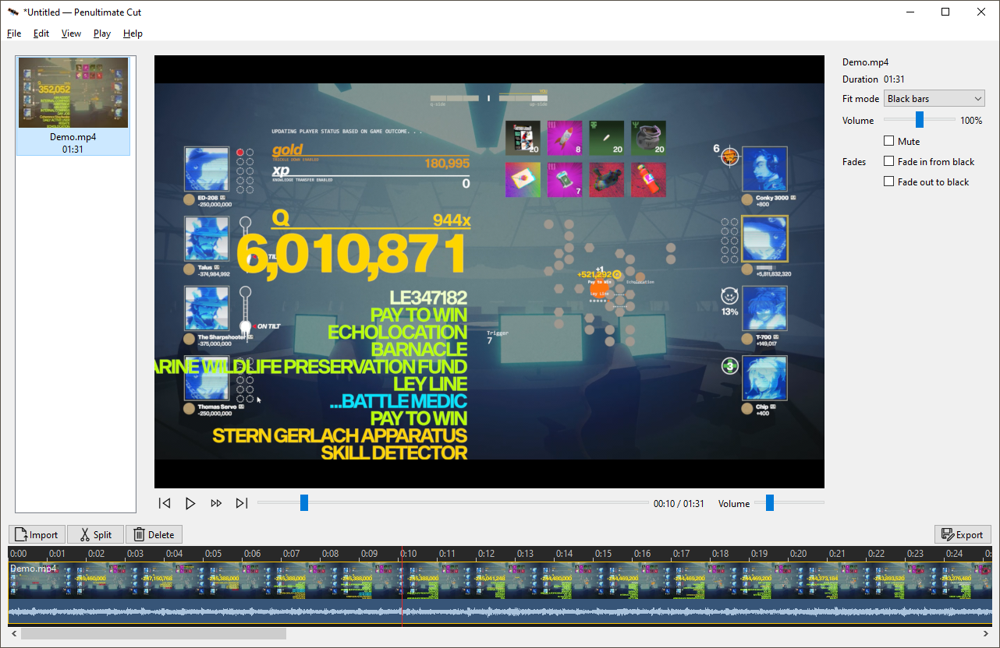

# Penultimate Cut

A simple video editor for Windows. 

Penultimate Cut is for people who need to get a video *done*: a class
assignment, a narrated slideshow, a training clip, a group project stitched
together from everyone's pieces, or family footage. 

The editor is designed to be fast and minimal, for people who need basic 
editing capabilities. If you've used Windows Movie Maker, the layout will 
feel familiar: the preview is on top, the timeline is below, there are a 
few big buttons, and everything else is a right-click away.

It runs entirely on your computer. You don't need an account or an internet
connection, and nothing is uploaded.



## What it does

- **Opens what you have.** Phone videos, screen recordings, old camcorder
  files (AVI, WMV, MPG, MOV, FLV, MKV, MP4) and still images. Drag them in or
  click Import.
- **Cut, trim, rearrange.** Split at the playhead, drag clips to reorder them,
  and drag a clip's edges to trim it. Delete a section and either leave a gap
  or close it up. Every change can be undone.
- **Simple sound and fades.** Each clip has its own volume and a mute switch,
  and can fade in from black or fade out to black.
- **Mixed shapes handled.** A vertical phone clip in a widescreen video can
  have black bars, a blurred background, or be cropped to fill the frame.
- **Scales to long videos.** Hours of footage stay responsive. The timeline
  shows thumbnails and the audio waveform, and you can zoom with the mouse
  wheel.
- **Export that just works.** Three choices: size, quality ("Small file",
  "Balanced", "High quality") and file name, plus an estimate of how big the
  file will be. The result is a standard MP4 that plays in every browser,
  learning management system (LMS) and media player.
- **Projects you can take elsewhere.** Projects are saved as OpenTimelineIO
  (`.otio`) files, which DaVinci Resolve and other editors can import if you
  outgrow this one. It saves your work automatically, and if a video file has
  moved it helps you find it again.

## What it isn't

Penultimate Cut has no tools or modes to switch between. You split a clip at
the playhead with one button (or the **S** key), and each clip's settings fit
in one small panel. It deliberately leaves out effects, color grading,
keyframe animation, transition libraries, masks, multi-track compositing,
stickers and stock media. It aims to be *finished* rather than ever-growing:
a small set of features that make it easier to finish a video without having
to learn anything first.

If you need more than that, these free, open-source editors are excellent:

- **[OpenShot](https://www.openshot.org)** (Windows, macOS, Linux) has
  unlimited tracks, keyframe animation, a large effects and transitions
  library, color grading with scopes, animated titles, and screen and webcam
  recording.
- **[Shotcut](https://shotcut.org)** and **[Kdenlive](https://kdenlive.org)**
  (Windows, macOS, Linux) are full-featured editors for multi-track editing,
  filters and audio work.
- **[OpenCut](https://opencut.app/)** runs in your web
  browser, so it's a good choice if you're not on Windows or can't install
  software.

[DaVinci Resolve](https://www.blackmagicdesign.com/products/davinciresolve/) is free but not open source. It offers professional-grade
color and audio tools, and it can import Penultimate Cut projects.

See `CLAUDE.md` for the full project brief (goals, architecture, feature phases).

## Download

Get the Windows installer (`PenultimateCutSetup-x.y.z.exe`) from the
[Releases page](https://github.com/xaintly/penultimate-cut/releases/latest).
Windows 10/11, 64-bit. Everything it needs (including ffmpeg) is bundled;
Python isn't required.

## Code signing policy

Free code signing provided by [SignPath.io](https://about.signpath.io),
certificate by [SignPath Foundation](https://signpath.org).

- Committers and reviewers: [xaintly](https://github.com/xaintly)
- Approvers: [xaintly](https://github.com/xaintly)

Release installers are built from this repository's source by GitHub
Actions (`.github/workflows/build-windows.yml`); only those builds are signed.

## Privacy policy

This program will not transfer any information to other networked systems
unless specifically requested by the user or the person installing or
operating it. It does not collect usage data, check for updates, or contact
any server; your videos and projects stay on your computer.

## Development setup

Requires Python 3.12+.

```bash
python3.12 -m venv .venv
source .venv/bin/activate
pip install -e ".[dev]"
```

Run the app:

```bash
python -m penultimate_cut.app
```

Run tests:

```bash
pytest
```

Lint and type-check:

```bash
ruff check .
mypy penultimate_cut/model penultimate_cut/export
```

Building the installer and making a release: see
[`docs/building.md`](docs/building.md).

## License

GPL-3.0-or-later (see `LICENSE`). The bundled ffmpeg build includes
`libx264` for H.264 encoding, which is itself GPL-licensed -- distributing
it requires the whole program to be GPL too.

The installed app carries the licenses and source locations of everything it
bundles (FFmpeg, mpv, Qt for Python, OpenTimelineIO, Python) in its `licenses`
folder, linked from **Help → About**; see
[`packaging/THIRD_PARTY_NOTICES.txt`](packaging/THIRD_PARTY_NOTICES.txt).
